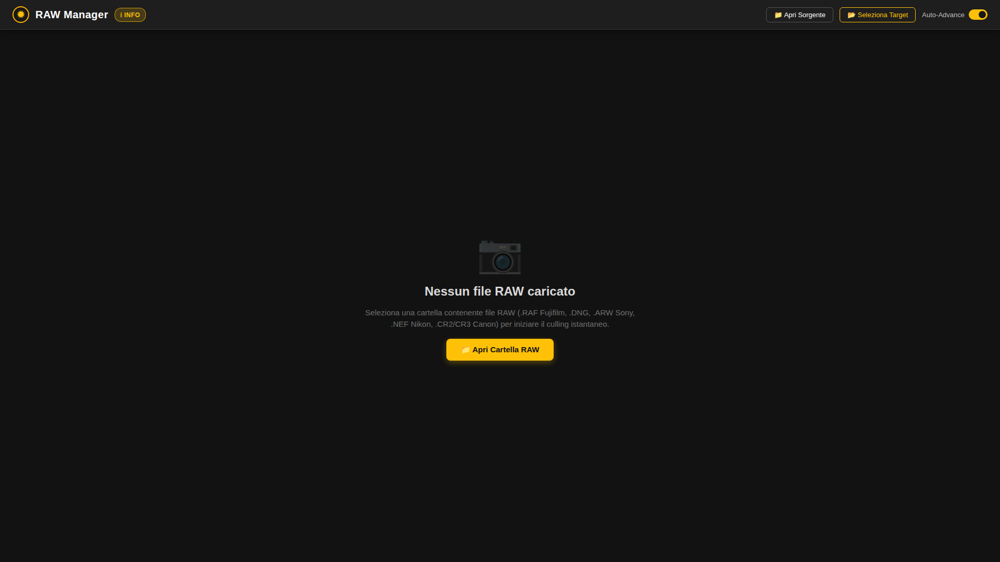
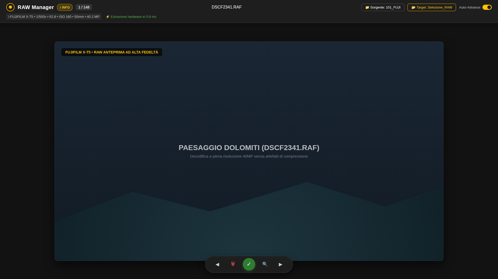
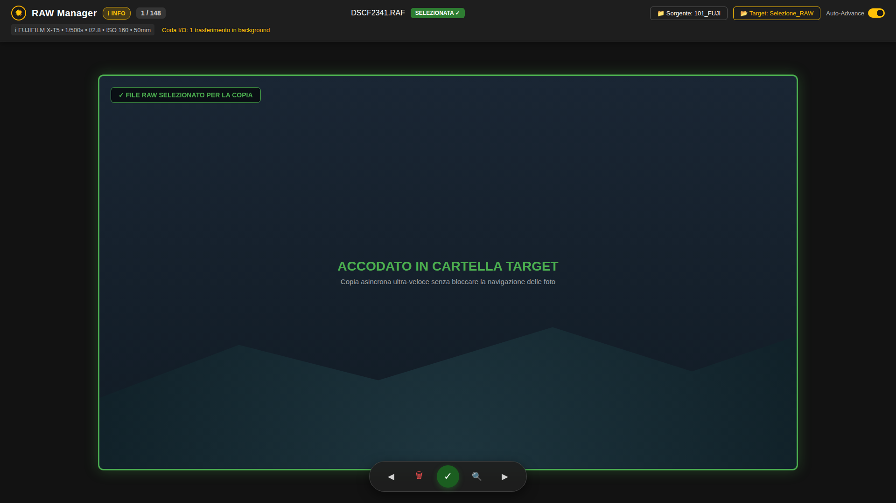
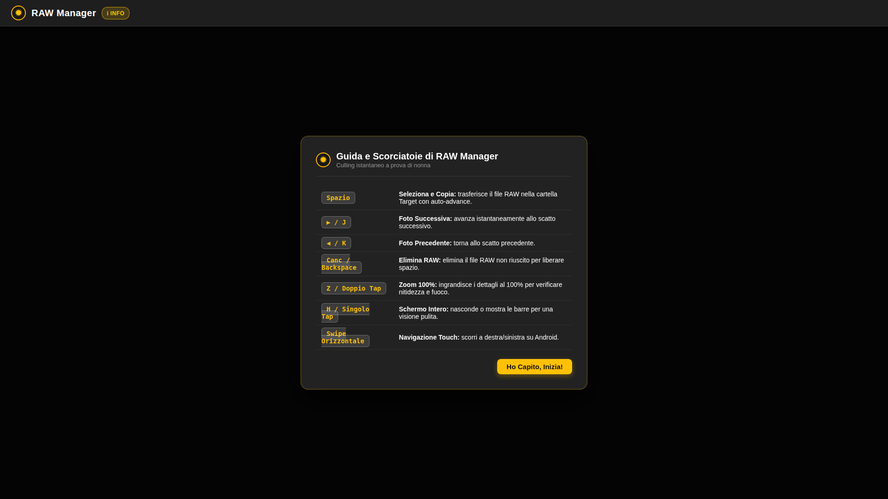

<div align="center">
  
  <h1>RAW Manager</h1>
  <p><b>Culling fotografico ultra-reattivo (&lt;10ms) per Fujifilm RAF (X-T5) e formati RAW universali</b></p>
  
  <p>
    <a href="https://github.com/NewtonH725/raw-manager/releases/latest"></a>
    
    
    
    <a href="docs/RAW_Manager_Guida_Ufficiale.pdf"></a>
  </p>
</div>

---

## ⚡ Caratteristiche Principali

- **Estrazione Binaria ad Accesso Casuale (< 6 ms):** Legge direttamente i puntatori binari JPEG nell'header di 92 byte dei file Fujifilm `.RAF` (offset `0x54` e `0x58`), evitando di decodificare l'intera matrice RAW da 40 MP.
- **Supporto RAW Universale (inclusi Ricoh GR IIIx DNG):** Compatibile con `.RAF` (Fujifilm X-T5, X-H2, X-T4), `.DNG` (Ricoh GR IIIx, Adobe, Leica — con parsing completo SubIFD/StripOffsets e filtro Lossless SOF3), `.ARW` (Sony Alpha), `.NEF` (Nikon), `.CR2`/`.CR3` (Canon).
- **UI Adaptive Smartphone / Tablet:** Interfaccia ottimizzata sia per schermi compatti (Google Pixel 9 Pro XL) che per grandi tablet (Samsung Galaxy Tab S10 Ultra) e Desktop.
- **Auto-Aggiornamento in-App (GitHub Releases):** Controlla automaticamente all'avvio se esistono nuove versioni e permette di scaricare e installare l'aggiornamento con un clic tramite pop-up Material 3.
- **Finestra Scorrevole di Prefetching `[i-2, i+3]`:** Precarica in RAM le foto adiacenti in background: il passaggio tra uno scatto e l'altro è istantaneo, senza attese di I/O su disco.
- **Copia Asincrona Non Bloccante:** La selezione (tasto `Spazio`) accoda la copia del file nella cartella *Target* e passa immediatamente alla foto successiva (*Auto-Advance*).
- **Barra Superiore Material 3 Fissa:** I comandi e i metadati sono ancorati in cima allo schermo senza mai coprire la visualizzazione della foto.
- **Zoom 100% per Verifica Fuoco:** Ingrandimento 1:1 istantaneo (`Z` o doppio tap) per controllare la nitidezza critica e la messa a fuoco sugli occhi.
- **Gesture Touch su Android:** Swipe laterale fluido per avanzare e retrocedere tra gli scatti, con supporto completo a schede SD e lettori USB-C OTG.

---

## 📸 Galleria Schermate

| 1. Schermata Iniziale | 2. Schermata di Culling Attivo |
| :---: | :---: |
|  |  |
| *Avvio rapido e apertura cartelle* | *Estrazione in 5.8ms con metadati EXIF completi* |

| 3. Foto Selezionata per la Copia | 4. Guida Rapida e Scorciatoie |
| :---: | :---: |
|  |  |
| *Badge verde e copia asincrona in background* | *Finestra d'aiuto interattiva a prova di nonna* |

---

## 📦 Download Eseguibili e Versioni (Releases)

Tutte le versioni precompilate sono disponibili nella sezione [**GitHub Releases**](https://github.com/NewtonH725/raw-manager/releases/latest):

| Piattaforma | Pacchetto | Tipo | Descrizione |
| :--- | :--- | :--- | :--- |
| **🪟 Windows (x64)** | [**`RAW_Manager_v1.2.1_Windows_x64_Setup.exe`**](https://github.com/NewtonH725/raw-manager/releases/latest) | Installer | Setup guidato Inno Setup, icona Desktop, Menù Start, disinstallatore pulito |
| **🪟 Windows (x64)** | [**`RAW_Manager_v1.2.1_Windows_x64_Portable.zip`**](https://github.com/NewtonH725/raw-manager/releases/latest) | Portable | Eseguibile autonomo senza installazione, utilizzabile anche da chiavetta USB |
| **📱 Android** | [**`RAW_Manager_v1.2.1_Android_arm64.apk`**](https://github.com/NewtonH725/raw-manager/releases/latest) | APK | Compatibile con Android 10..17, Adaptive UI & Icons, supporto schede SD USB-C OTG |
| **🐧 Linux** | [**`RAW_Manager_v1.2.1_Ubuntu_x64_Bundle.tar.gz`**](https://github.com/NewtonH725/raw-manager/releases/latest) | Bundle | Applicazione desktop nativa XDG con avvio istantaneo e lanciatore `.desktop` |
| **📄 Documentazione** | [**`RAW_Manager_Guida_Ufficiale.pdf`**](docs/RAW_Manager_Guida_Ufficiale.pdf) | PDF | Manuale utente illustrato a colori di 6 pagine con flussi operativi completi |

---

## ⌨️ Scorciatoie da Tastiera e Gesture Touch

| Comando / Tasto | Gesto Touch | Azione | Descrizione |
| :--- | :--- | :--- | :--- |
| <kbd>Spazio</kbd> | Tasto verde **✓** | **Seleziona e Copia** | Accoda la copia del RAW nella cartella Target con auto-advance |
| <kbd>→</kbd> / <kbd>J</kbd> | **Swipe Sinistra** | **Foto Successiva** | Avanza istantaneamente allo scatto successivo (&lt;10ms) |
| <kbd>←</kbd> / <kbd>K</kbd> | **Swipe Destra** | **Foto Precedente** | Ritorna allo scatto precedente |
| <kbd>Canc</kbd> / <kbd>Backspace</kbd> | Cestino rosso | **Elimina RAW** | Elimina fisicamente lo scarto dal disco per liberare spazio |
| <kbd>Z</kbd> | **Doppio Tap** | **Zoom 100% / Fit** | Alterna tra vista intera e ingrandimento 1:1 per controllo fuoco |
| <kbd>H</kbd> | **Singolo Tap** | **Schermo Intero** | Nasconde o mostra le barre per una visione completamente pulita |
| <kbd>I</kbd> / <kbd>F1</kbd> | Badge **INFO** | **Guida Rapida** | Mostra la finestra interattiva delle scorciatoie |

---

## 📁 Documentazione di Progetto

Tutta la documentazione tecnica e la cronologia dello sviluppo sono archiviate nella cartella [`docs/`](docs/):
- **[`docs/RAW_Manager_Guida_Ufficiale.pdf`](docs/RAW_Manager_Guida_Ufficiale.pdf):** Manuale utente ufficiale a colori in formato PDF.
- **[`docs/STORICO_CONVERSAZIONE_E_SVILUPPO.md`](docs/STORICO_CONVERSAZIONE_E_SVILUPPO.md):** Diario cronologico di tutte le conversazioni, analisi dei bug (Riverpod state reset, SAF USB OTG partial read, adaptive icons) e decisioni architetturali.
- **[`GUIDA_UTENTE.md`](GUIDA_UTENTE.md):** Guida rapida markdown integrata nell'applicazione desktop e mobile.

---

## 🛠️ Compilazione da Sorgente

### Linux Desktop (Ubuntu / Debian)
```bash
flutter pub get
flutter test
flutter build linux --release
```

### Android APK
```bash
flutter build apk --release --split-per-abi
```

### Windows (tramite batch o GitHub Actions)
Sul PC Windows con Visual Studio 2022 C++ installato:
```cmd
build_windows.bat
```
Oppure tramite la pipeline cloud configurata in [`.github/workflows/build_windows.yml`](.github/workflows/build_windows.yml).

---

<div align="center">
  <sub>Sviluppato con Architettura DOE per Fotografi • Autore: NewtonH725</sub>
</div>
